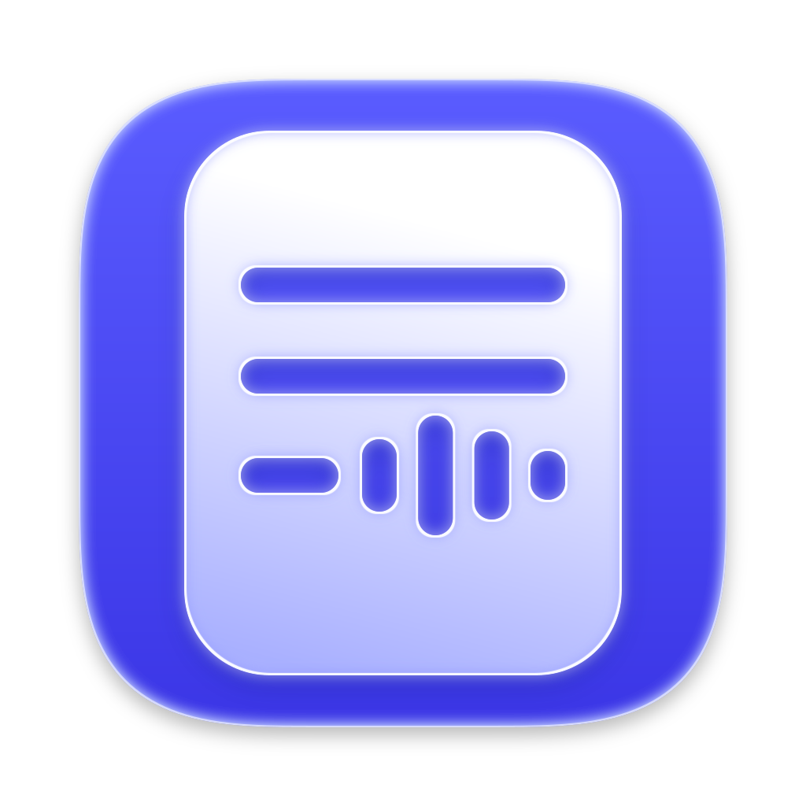

<p align="center"></p>

# Transcriber

A small Mac app that turns audio files into text transcripts, fully on-device, using the
speech models you've already downloaded in [Handy](https://handy.computer).

Drop mp3/m4a/wav files on the window (or the Dock icon), and a `.txt` transcript is written
next to each one. Shows per-file and whole-batch progress: percent, audio time done, word
count, elapsed, ETA, and speed vs realtime.

## Models

Anything Handy has downloaded shows up in the toolbar's model picker:

| Model | Engine | Speed (5 min audio, M3) | Notes |
|---|---|---|---|
| Parakeet V3 | [onnx-asr](https://github.com/istupakov/onnx-asr), CPU | ~12 s | Most accurate, 25 languages |
| Canary 180M Flash | [transcribe.cpp](https://github.com/handy-computer/transcribe.cpp), Metal | ~8 s | Lighter (~430 MB RAM), en/de/es/fr |

Transcription runs on half the CPU cores at low priority so the Mac stays responsive.

## Requirements

- macOS 14+ (Apple Silicon)
- [Handy](https://handy.computer) with at least one model downloaded
- [uv](https://docs.astral.sh/uv/) (`brew install uv`). It installs the Python dependencies on first run.
- Xcode or the Command Line Tools (to build)

## Build & install

```bash
./build.sh
```

Builds `Transcriber.app`, ad-hoc signs it, and installs it to `~/Applications`.

## Command line

The app is a thin SwiftUI wrapper around `transcribe.py`, which also works on its own:

```bash
uv run transcribe.py --list                                   # installed models
uv run transcribe.py --model parakeet-tdt-0.6b-v3-int8 a.mp3 b.m4a
```

## Layout

```
transcribe.py                         model discovery + transcription (progress on stdout)
Transcriber/Sources/Transcriber/      SwiftUI app
Transcriber/AppIcon.icns, icon.svg    app icon
Transcriber/icons/                    icon explorations
build.sh                              build + bundle + install
```
